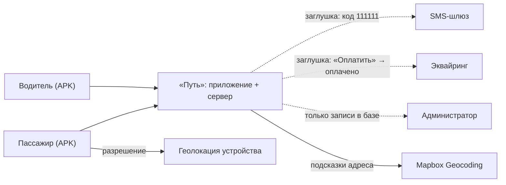
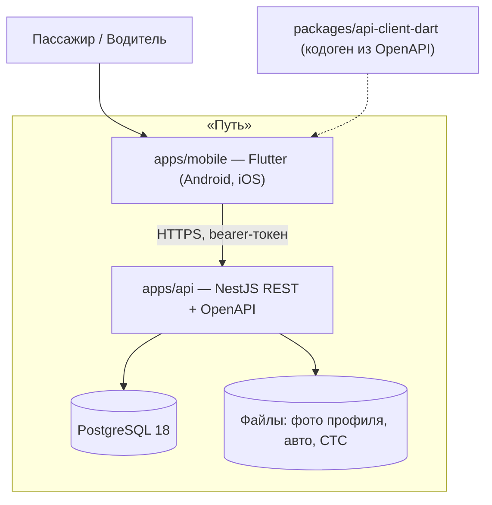
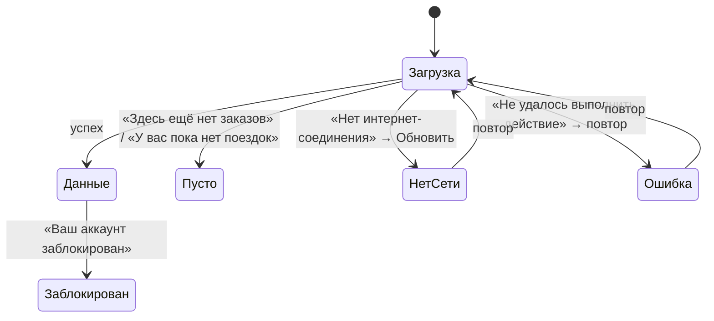
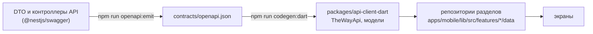

# Архитектура «Путь» (The Way)

Один монорепозиторий, два приложения и порождаемый контракт между ними. Сервер — REST API с
OpenAPI-схемой, из схемы порождается Dart-клиент; мобильное приложение не содержит бизнес-правил
(лимиты, блокировки, статусы, цены) — всё считает сервер, приложение показывает ответ.

Требования — [`REQUIREMENTS.md`](REQUIREMENTS.md); модель данных, правила и эндпоинты —
[`SPECIFICATION.md`](SPECIFICATION.md); стенд — [`DEPLOYMENT.md`](DEPLOYMENT.md).

## Контекст системы

## Контейнеры

| Часть | Технологии | Точка входа |
| --- | --- | --- |
| `apps/api` | TypeScript, Node.js 24, NestJS 12, Drizzle ORM, `pg`, `class-validator`, `@nestjs/swagger`, Jest | `apps/api/src/main.ts` |
| `apps/mobile` | Flutter 3.47, Dart; `dio`, `flutter_secure_storage`, `image_picker`, `geolocator`, `flutter_svg`, `intl`, ARB-локализация | `apps/mobile/lib/main.dart` |
| `packages/api-client-dart` | `swagger_parser` + `retrofit`/`json_serializable` | порождается из `contracts/openapi.json` |
| PostgreSQL 18 | Docker | миграции `apps/api/drizzle/` |

## Сервер: модули

Модульный монолит. Модуль — каталог `apps/api/src/modules/<модуль>/`: наружу — `*.module.ts`,
внутри `internal/` — контроллер, DTO, сервис, схема таблиц. Модули не вызывают сервисы друг
друга: общее чтение (карточки поездок, брони, рейтинг, профиль) — `apps/api/src/common/views.ts`,
общие правила — `apps/api/src/common/`.

| Модуль | Ответственность | Эндпоинты |
| --- | --- | --- |
| `auth` | вход по телефону и коду, сессии, выход, проверка живости | `POST /auth/request-code`, `POST /auth/verify`, `POST /auth/logout`, `GET /health` |
| `users` | профиль (имя, фото, город, режим), публичная карточка, полученные жалобы; таблицы отмен и блокировок | `GET/PATCH /me`, `GET /me/complaints`, `GET /users/{id}/public` |
| `cities` | справочник населённых пунктов с координатами | `GET /cities` |
| `files` | загрузка и выдача фото (JPEG, PNG, WebP, до 10 МБ) | `POST /files`, `GET /files/{id}` |
| `cars` | автомобили водителя, СТС; авто проверяется сервером сразу | `GET/POST /cars`, `PATCH /cars/{id}`, `DELETE /cars/{id}`, `POST /cars/{id}/documents` |
| `geo` | подсказки адреса остановки через Mapbox | `GET /geo/suggest` |
| `trips` | поездки, остановки, цены отрезков, услуги, лимиты, обратная поездка, места, закрытие приёма, отмена, шаблоны маршрутов, лента поиска | `/trips…`, `/route-templates…` |
| `bookings` | расчёт цены, брони, подтверждение и отклонение, «оплата», отмена, события «при открытии» | `/trips/{id}/quote`, `/trips/{id}/bookings`, `/bookings…`, `/updates…` |
| `orders` | заказ пассажира — встречная сторона поездки: пассажир публикует маршрут, дату, места или посылку и услуги без цены; водитель видит ленту заказов и откликается своей или новой поездкой — сразу бронь «Ожидает оплаты» | `POST /orders`, `GET /orders`, `GET /orders/mine`, `GET /orders/{id}`, `POST /orders/{id}/cancel`, `POST /orders/{id}/respond` |
| `reviews` | отзывы и жалобы (схема и чтение; интерфейса подачи нет) | `GET /users/{id}/reviews` |
| `logs` | приём ошибок клиента в лог сервера | `POST /client-logs` |

Общее (`apps/api/src/common/`):

| Файл | Что |
| --- | --- |
| `auth.guard.ts` | глобальная охрана: bearer-токен → живая сессия → пользователь в контексте запроса; открыты только `/auth/*`, `GET /health`, `GET /cities`, `POST /client-logs`; аккаунт, заблокированный администратором, — 403 `account_blocked` |
| `block.guard.ts` | глобальная охрана блокировки за отмены: публикация, обратная поездка и бронирование → 403 `blocked` с `blockedUntil` |
| `cancellations.ts` | единственное место записи отмен и блокировок |
| `errors.ts` | коды ошибок и единое тело ошибки `{code, message, blockedUntil?}` |
| `views.ts` | формы чтения: карточка поездки (флаги, дубли, плашки), бронь, рейтинг, число поездок, профиль |
| `logger/` | структурный лог одной JSON-строкой с `trace_id` и `user_id` запроса |

Слои внутри модуля: контроллер (HTTP, DTO, OpenAPI) → сервис (правила, транзакции) →
репозиторий или Drizzle-запросы. Контроллер не знает о правилах, сервис не знает об HTTP —
нарушение правила он бросает как `AppError('<код>')`, тело и статус ответа ставит фильтр ошибок.

## Приложение: разделы

| Каталог `apps/mobile/lib/src/` | Что |
| --- | --- |
| `app/` | сессия (`session.dart`), HTTP-клиент и перехватчики (`http.dart`), маршруты (`app_routes.dart`), оболочка с нижней панелью «Поездки · Мои заказы · Чаты · Профиль» (`home_shell.dart`), проверка событий при открытии (`updates_watcher.dart`) |
| `features/onboarding`, `city`, `auth`, `profile_setup` | онбординг, выбор города, вход по номеру и коду, создание профиля и выбор роли |
| `features/search` | лента поездок, фильтр, детали поездки; у водителя — вкладка «Заказы пассажиров» и шторка отклика (`orders/`) |
| `features/booking` | бронирование (`new/`), окна ответов водителя (`answers/`), отмена брони (`cancel/`) |
| `features/passenger_trips` | «Мои заказы» пассажира, детали брони и заказа (`order/`) |
| `features/orders` | репозиторий заказов пассажиров над клиентом API — общий для экранов пассажира и водителя |
| `features/trip_new` | мастер создания поездки и заказа пассажира (тот же мастер без цены и авто), отклик новой поездкой |
| `features/driver_trips` | «Мои поездки» водителя, детали, правка, места, закрытие приёма, отмена |
| `features/driver_bookings` | заявки поездки, профиль пассажира, подтверждение и отклонение, события водителя |
| `features/cars` | транспортные средства: список, добавление и правка, СТС («Заменить») |
| `features/profile` | профиль, смена режима, личные данные (`personal_data/`), полученные жалобы (`complaints/`), выход |
| `features/system` | системные экраны: нет сети, ошибка, аккаунт заблокирован, аккаунт временно заблокирован (блокировка за отмены), раздел в разработке |
| `widgets/` | общие виджеты по компонентам макета |
| `theme/` | `AppColors`, `AppType`, `AppSize` — порождены из токенов дизайна |

Раздел устроен одинаково: экран → репозиторий раздела (`data/`) над `TheWayApi` → общий `Dio`.
Состояние экрана — `ChangeNotifier`/`FutureBuilder`. Строки — `lib/l10n/app_ru.arb`.

Перехватчики `Dio` (`app/http.dart`): токен в каждый запрос; `traceparent`; ошибки сети и 5xx
уходят в `POST /client-logs`; 401 вне `/auth/*` — снять токен и перейти ко входу; 403
`account_blocked` — экран блокировки аккаунта; 403 `blocked` (блокировка за отмены) — экран
«Аккаунт временно заблокирован» с текстом по роли запроса; нет сети или 5xx на действии
(POST, PATCH, DELETE) — системный экран с повтором того же запроса; ошибки загрузки показывает
сам экран.

## Поток данных: контракт → клиент

Контракт — побочный продукт кода сервера, клиент — побочный продукт контракта; оба порождённых
файла лежат в репозитории. Изменение формы запроса или ответа без перегенерации клиента ломает
компиляцию приложения, а не проверку у пользователя. Имя операции в контракте = имя метода
контроллера, его же получает метод Dart-клиента.

Поток запроса: экран → репозиторий → `TheWayApi` → `Dio` (токен, `traceparent`) → HTTPS → nginx →
NestJS: `requestContext` (trace id) → лог запроса → охрана токена → охрана блокировки → проверка
тела → контроллер → сервис (транзакция Drizzle) → PostgreSQL → форма ответа из `common/views.ts`.

## Ключевые решения

**Сессия — непрозрачный токен, в базе хэш.** Токен — 32 случайных байта (`base64url`), в таблице
`sessions` — его SHA-256; срок — 30 суток. Почему: сессию обязаны уметь прекратить (выход), а
строка в базе даёт это сама; утечка базы не даёт рабочих токенов. Чем заплачено: каждый запрос —
поиск сессии в базе (одна выборка по первичному ключу).

**Бизнес-правила — только на сервере.** Лимиты, дубли, цены, места, статусы, отмены и блокировки
считает API; клиент выбирает экран по полям ответа и коду ошибки. Почему: одно место правды,
правила проверяются интеграционными тестами через HTTP, приложение нельзя «уговорить». Чем
заплачено: на каждое окно с последствиями — отдельный запрос предпросмотра
(`cancel-preview`, `quote`).

**Места — под `SELECT … FOR UPDATE` строки поездки.** Создание брони, подтверждение, оплата,
отмена и правка мест блокируют строку `trips` в транзакции и перечитывают статус и места после
блокировки. Почему: два пассажира не займут последнее место дважды — второй получает `no_seats`.
Чем заплачено: действия над одной поездкой выполняются последовательно.

**События «при открытии» вместо push.** У брони два поля «последний увиденный статус» — для
пассажира и для водителя; `GET /updates` отдаёт брони, чей статус сторона ещё не видела
(новая заявка, пассажир оплатил, водитель принял, водитель отклонил), приложение показывает их
окнами на старте, при возврате на передний план и каждые 30 секунд, пока приложение на переднем плане
(жест «потянуть вниз» проверяет сразу), затем отмечает `POST /updates/{id}/seen`.
Почему: без push-инфраструктуры и ключей сторонних сервисов. Чем заплачено: ответ второй стороны
виден с задержкой до 30 секунд, а в фоне — при следующем открытии.

**Ранжирование и дубли — одной функцией чтения.** Лента сортируется по рейтингу водителя ↓ (водители без
отзывов — после водителей с отзывами), времени отправления ↑; дубли (одни города начала и конца и одно время отправления) группируются,
бронируема только первая в группе. Признаки карточки (`registrationOpen`, `bookable`, плашка
«Топ» / «Ближайший») считает `common/views.ts` — одна функция для ленты, деталей и броней.
Почему: карточка выглядит одинаково везде, где появляется. Чем заплачено: карточка тяжелее
простой выборки (несколько запросов на пачку поездок).

**Геокодинг — через свой эндпоинт.** Подсказки адреса — `GET /geo/suggest`, ключ Mapbox живёт
только на сервере; без ключа, при ошибке или таймауте — пустой список, адрес вводится строкой.
Выбранная подсказка пополняет справочник населённым пунктом, которого в нём не было; название
пункта берётся на русском (`name_preferred`), даже если запрос набран латиницей. Почему:
ключ не попадает в APK, отказ внешнего сервиса не ломает сценарий.

**Справочник городов — открытый набор.** 1117 городов России с координатами (hflabs/city,
CC BY-SA 4.0) заливаются seed-ом; сёла и пункты вне справочника приходят из подсказок адреса.
Расстояния («поблизости», километраж) — по координатам адреса, без них — по координатам города.
Почему: без платного API и без карты, которой нет в макете.

**Логи с `traceparent`.** Приложение отправляет W3C `traceparent`, сервер берёт из него trace id
(или создаёт новый и возвращает заголовком), каждая строка лога — JSON с `trace_id` и `user_id`;
ошибки клиента приходят в тот же лог через `POST /client-logs`. Почему: одна ошибка у
пользователя находится в логе сервера по одному идентификатору. Продуктовая аналитика не
собирается.

**`ChangeNotifier` без сторонних менеджеров состояния.** Сессия — `ChangeNotifier` в
`InheritedNotifier`, экраны — `FutureBuilder` и локальные контроллеры. Почему: экраны в
основном читают ответ сервера и показывают его; каркас состояния не окупается. Чем заплачено:
обновление соседнего экрана после действия — явным перечитыванием.

**Seed идёт путём приложения.** Демо-данные создаются вызовами тех же сервисов с той же проверкой
тел, что у HTTP-запросов (вход по коду, профиль, авто, публикация, брони и переходы); напрямую в
базу пишется только то, для чего у приложения пути нет (справочник городов, прошлое время
завершённых поездок, отзывы, жалоба). Почему: демо-данные не могут нарушить правило, которое
проверяет приложение.

**Миграции при старте.** API применяет миграции до приёма первого запроса. Почему: процесс не
обслуживает трафик на старой схеме, обновление стенда — один перезапуск.
