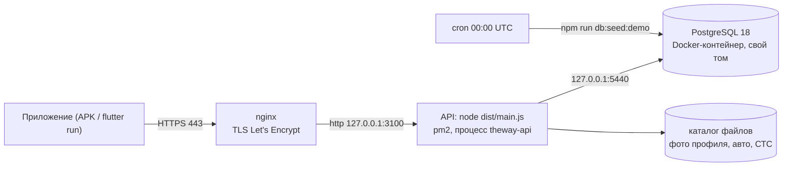

# Развёртывание «Путь» (The Way)

Стенд для проверки — `https://theway.dabooke.com`: Linux-VPS вне России, на котором сервер
работает из клона репозитория. Файлы конфигурации — `deploy/` репозитория; локальный запуск —
[`README.md`](../README.md).



## Состав

| Часть | Как устроено |
| --- | --- |
| PostgreSQL | Docker-контейнер `postgres:18.6` со своим томом, ограничение памяти 256 МБ, порт только на `127.0.0.1`, перезапуск `unless-stopped` |
| Node.js | 24-я версия в отдельном каталоге стенда (системный Node на VPS старше требуемого `>=24` и не трогается); там же `pm2` |
| API | клон репозитория (ветка `main`), `npm ci` и `npm run build --workspace=api`; процесс `theway-api` под `pm2` по `deploy/ecosystem.config.cjs`: `dist/main.js`, переменные — `--env-file`, перезапуск при памяти больше 400 МБ, автозапуск после перезагрузки VPS (`pm2 startup` + `pm2 save`) |
| Миграции | применяются самим API при старте, до приёма запросов |
| nginx | `deploy/nginx-the-way.conf`: HTTP → HTTPS, TLS 1.2/1.3, HTTP/2, прокси на `127.0.0.1:3100` с заголовками `X-Forwarded-*` и `traceparent`, тело запроса до 12 МБ (загрузка фото до 10 МБ) |
| Сертификат | Let's Encrypt, `certbot certonly --webroot`; первый выпуск — через временный конфиг `deploy/nginx-the-way-acme.conf` (только ACME-проверка), продление — штатный таймер certbot |
| Доступ к репозиторию | клон читает GitHub отдельным deploy key только на чтение |

## Переменные окружения

Файл переменных лежит вне клона, права `600`; значения в git не попадают. Имена — те же, что в
`.env.example`:

| Имя | Что |
| --- | --- |
| `DATABASE_URL` | строка подключения к PostgreSQL стенда |
| `PORT` | порт API (`3100`) |
| `APP_TZ` | часовой пояс суток для лимитов и демо-данных (`Europe/Moscow`) |
| `PUBLIC_ORIGIN` | публичный адрес стенда |
| `MAPBOX_TOKEN` | ключ подсказок адреса; без него подсказок нет, остальное работает |
| `FILES_DIR` | каталог загруженных файлов (по умолчанию `apps/api/data/files`) |

Любая ручная команда API на VPS выполняется с этими переменными в окружении
(`set -a; . <файл переменных>; set +a`) и с Node 24 в `PATH`.

## Обновление

`deploy/update.sh`:

```sh
git pull --ff-only
npm ci
npm run build --workspace=api
(cd apps/api && npm run db:migrate)
pm2 restart theway-api --update-env
```

Демо-данные при обновлении не трогаются. Полная перезаливка демо-данных (очищает все таблицы и
каталог файлов) — `npm run db:seed` из `apps/api` с переменными стенда.

## Демо-данные

- **Первичная заливка** — `npm run db:seed`: города, демо-пользователи, авто, поездки, брони во
  всех статусах, история завершённых поездок с отзывами, жалоба (номера — в `README.md`).
- **Ночное пополнение** — `deploy/demo-cron`: каждый день в 00:00 UTC (03:00 по Москве)
  `npm run db:seed:demo` добавляет демо-водителям поездки на дни «сегодня … сегодня + 3», где их
  ещё нет, — тем же путём и с теми же проверками (лимит, время, цены), что публикация из
  приложения. Ничего не удаляет; брони и данные проверяющего остаются.

## Логи

| Что | Где |
| --- | --- |
| API — запросы и события | stdout процесса → файл `api.out.log` в каталоге логов стенда; одна JSON-строка на запись с `time`, `level`, `trace_id`, `user_id` |
| API — ошибки процесса | `api.err.log` там же |
| Ночное пополнение | `demo-cron.log` там же |
| Ошибки клиента | приходят `POST /client-logs` и пишутся в тот же лог API |

**Ротация** — модуль `pm2-logrotate`: файл до 10 МБ, хранится 10 последних. Найти запрос —
поиск по `trace_id` (его же видно в заголовке `traceparent` ответа).

## Проверка

```sh
curl -s https://theway.dabooke.com/health
# {"ok":true}

curl -s -X POST https://theway.dabooke.com/auth/verify \
  -H 'content-type: application/json' \
  -d '{"phone":"+79000000011","code":"111111"}'
# JSON с token и профилем
```

Swagger UI — `https://theway.dabooke.com/docs`.

## Своё развёртывание

Те же шаги на любом Linux-сервере: PostgreSQL 18 (в Docker или пакетом), Node.js 24, клон
репозитория, `npm ci`, `npm run build --workspace=api`, переменные из таблицы выше,
`npm run db:seed` один раз из `apps/api`, запуск `node dist/main.js` из `apps/api` (под `pm2` —
`deploy/ecosystem.config.cjs`, пути поправить под свой сервер), nginx с TLS перед ним. Приложение
собирается под свой адрес: `flutter build apk --release --dart-define=API_URL=https://<адрес>`.
