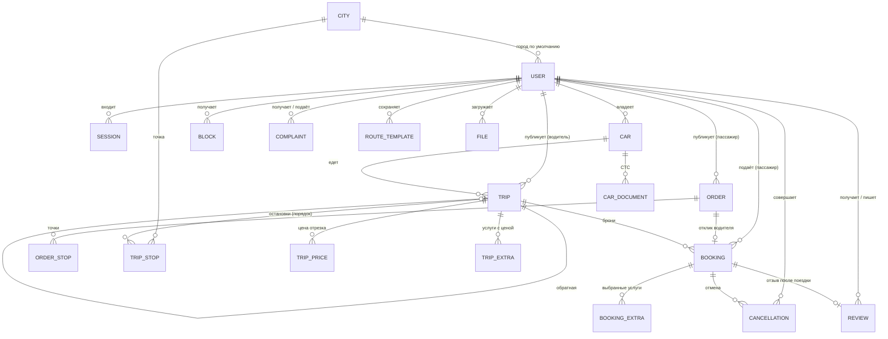
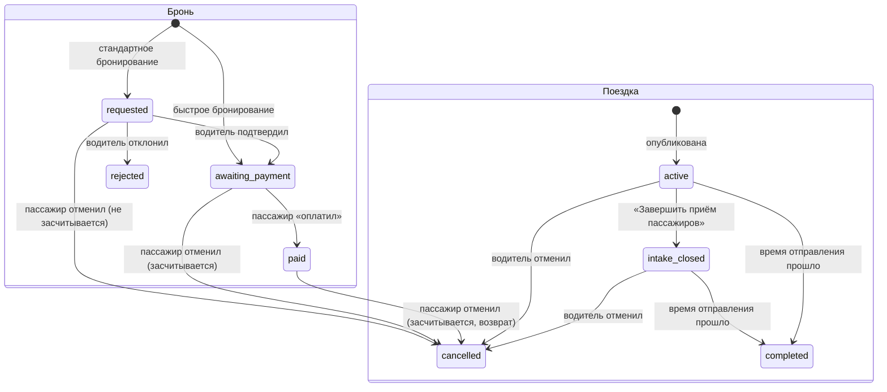

# Спецификация «Путь» (The Way)

Как система ведёт себя: модель данных, статусы, правила, ошибки и эндпоинты. Полный контракт
(тела, поля, коды ответов) — [`contracts/openapi.json`](../contracts/openapi.json); на работающем
сервере — Swagger UI по пути `/docs`. Устройство кода — [`ARCHITECTURE.md`](ARCHITECTURE.md).

## Модель данных

PostgreSQL 18, схема — `apps/api/src/modules/*/internal/schema.ts`, миграции —
`apps/api/drizzle/`. Время — `timestamptz`; деньги — целые рубли.

| Таблица | Что хранит | Ключевые поля |
| --- | --- | --- |
| `users` | пользователь, обе роли в одном аккаунте | `phone` (E.164, уникален), `name`, `photo_file_id`, `city_id`, `current_mode` (`passenger`/`driver`), `blocked_until` (блокировка за отмены), `admin_blocked` |
| `sessions` | сессии входа | `token_hash` (SHA-256 токена, 64 знака), `user_id`, `expires_at` (30 суток), `last_seen_at` |
| `cities` | справочник населённых пунктов | `name`, `region`, `lat`, `lng`, `source` (`seed` — открытый набор, `mapbox` — добавлен из подсказки адреса) |
| `files` | загруженные фото | `owner_id`, `mime`, `path`, `size` |
| `cars` | автомобили водителя | `brand`, `model`, `kind` (`car`/`bus`), `seats`, `plate`, `photo_file_id`, `status` (`verified` сразу), `deleted_at` |
| `car_documents` | СТС автомобиля | `car_id`, `kind` (`sts`), `file_id` |
| `admin_checks` | проверки администратора (интерфейса нет) | `subject_kind` (`user_photo`/`car`/`car_document`), `subject_id`, `status`, `note` |
| `trips` | поездка | `driver_id`, `car_id`, `kind` (`ride`/`parcel`), `vehicle_kind`, `departs_at`, `arrives_at`, `seats_total`, `seats_taken`, `price_full`, `price_boarding_min`, `booking_mode` (`standard`/`instant`), `status`, `reverse_of`, `parcel_only_allowed`, `parcel_seats_total`, `parcel_seats_taken`, `number` |
| `trip_stops` | остановки по порядку | `idx` (0 — начало), `city_id`, `address`, `lat`, `lng` |
| `trip_prices` | цены отрезков | `from_idx`, `to_idx`, `price` |
| `trip_extras` | услуги поездки с ценой водителя | `kind`: `child_seat`, `pets`, `luggage`, `parcel_s`, `parcel_m`, `parcel_l` |
| `route_templates` | сохранённые маршруты водителя | `stops` (JSON) |
| `bookings` | бронь пассажира | `trip_id`, `passenger_id`, `from_idx`, `to_idx`, `seats`, `parcel_size` (`none`/`S`/`M`/`L`), `parcel_only`, `parcel_comment`, `price_total`, `status`, `passenger_seen_status`, `driver_seen_status`, `confirmed_at`, `paid_at`, `rejected_at`, `cancelled_at`, `number` |
| `orders` | заказ пассажира — встречная сторона поездки | `number` (общая последовательность с бронями), `passenger_id`, `kind` (`ride`/`parcel`), `departs_at`, `arrives_at`, `seats` (1–8, у посылки 0), `parcel_size`, `parcel_comment`, `status` (`open`/`matched`/`cancelled`), `cancelled_at` |
| `order_stops` | точки заказа | `idx` (0 — откуда, последний — куда), `city_id`, `address`, `lat`, `lng` |
| `order_extras` | нужные пассажиру услуги | `kind`: `child_seat`, `pets`, `luggage` |
| `booking_extras` | выбранные услуги и размер посылки с ценой | `booking_id`, `kind`, `price` |
| `cancellations` | засчитанные отмены (для правила «2 за 30 дней») | `user_id`, `role` (`passenger`/`driver`), `booking_id` или `trip_id` |
| `blocks` | блокировки | `user_id`, `reason` (`cancellations`/`admin`), `starts_at`, `ends_at` |
| `reviews` | отзывы | `author_id`, `target_id`, `trip_id`, `booking_id`, `rating` (1–5), `body` |
| `complaints` | жалобы | `author_id`, `target_id`, `trip_id`, `reason`, `status` (`open`/`closed`) |

## Статусы

**Бронь.** Переходы — одна таблица (`apps/api/src/modules/bookings/internal/status-machine.ts`):
подтвердить и отклонить может только водитель поездки, оплатить и отменить — только пассажир
брони; перехода нет — `invalid_transition`. Отмена поездки водителем отменяет все её живые брони
(`requested`, `awaiting_payment`, `paid`).

| Статус | У пассажира | У водителя |
| --- | --- | --- |
| `requested` | «Ожидает подтверждения» | «Не подтвержден» |
| `awaiting_payment` | «Найден водитель», кнопка «Перейти к оплате» | «Ожидает оплаты» |
| `paid` | «Место забронировано» / «Посылка забронирована» | «Подтверждён» |
| `rejected` | «Отклонена» | — |
| `cancelled` | «Отменён» | — |
| поездка прошла | «Завершен» | «Завершен» |

**Заказ пассажира.** `open` — ждёт водителя; `matched` — водитель откликнулся, у заказа живая
бронь; `cancelled` — отменён пассажиром. Действующий статус в ответе — ещё `expired`: открытый
заказ с выездом в прошлом (считается при чтении). Отмена брони из заказа до оплаты (пассажир
отказался от отклика) или отмена поездки водителем снова открывает заказ; отмена оплаченной брони
закрывает его.

**Поездка.** Действующий статус считается при чтении: `cancelled` — отменена; `completed` — время
отправления наступило; иначе хранимый (`active` или `intake_closed`). Отдельной фоновой задачи
«завершить поездку» нет.

## Правила

### Вход и сессия

- Код подтверждения — `111111` для любого номера (SMS не отправляются); другой код —
  `invalid_code`. Ответ на запрос кода — `resendAfterSec: 60`: через столько приложение
  предлагает отправить код повторно.
- Номер приводится к E.164 (`+` и 8–15 цифр); первый вход создаёт пользователя.
- Токен сессии — 32 случайных байта; хранится SHA-256; срок — 30 суток; `POST /auth/logout`
  удаляет сессию, следующий запрос с тем же токеном — 401.
- Без токена доступны только `/auth/*`, `GET /health`, `GET /cities`, `POST /client-logs`.

### Профиль

- Правятся имя, фото, город, режим; номер телефона не меняется (лишнее поле тела — `validation`).
- Рейтинг — среднее оценок полученных отзывов до десятых; нет отзывов — 5 и «нет отзывов».
- «N поездок»: у водителя — его завершённые поездки, у пассажира — оплаченные брони на
  завершённых поездках.
- Телефон другого пользователя виден только второй стороне принятой брони (`awaiting_payment`,
  `paid`).
- «Жалобы» — жалобы, которые пользователь **получил** (`target_id`), новые сверху; только чтение.

### Автомобили

- Марка, модель, тип «Легковой» (от 1 до 8 мест) или «Автобус» (от 9 до 60), номер, фото; статус
  «Проверен» сервер ставит сразу.
- Госномер уникален у владельца среди неудалённых авто (сравнение без пробелов и знаков, заглавными)
  — иначе `car_plate_taken`.
- Правка (`PATCH /cars/{id}`) меняет только переданные поля с теми же проверками, что добавление;
  авто снова «Проверен». «Заменить» у СТС прикладывает новый файл (`POST /cars/{id}/documents`).
- Удалённое авто скрывается (`deleted_at`), опубликованные на нём поездки остаются.

### Публикация поездки

- Остановок не меньше двух; адрес — строка, координаты — из подсказки адреса или города.
- Время отправления кратно 30 минутам (`invalid_time_step`), не в прошлом, не дальше 3 суток
  (72 часов) от текущего момента (`too_far_ahead`); прибытие позже отправления.
- Места: поездка с пассажирами — от 1 до числа мест авто; поездка-посылка — 0 мест и хотя бы
  один размер посылки. Места для посылок — не меньше 1, если посылки возятся, иначе 0.
- Авто — своё и проверенное (`car_invalid`); вид транспорта поездки — по авто: легковое или
  автобус (в ленте — вкладки «Автомобили» / «Автобусы»).
- **Лимит** — на водителя по всем его авто: в сутки (дата отправления в часовом поясе `APP_TZ`) —
  одна неотменённая поездка «туда» и одна обратная; в календарную неделю (пн–вс) — не больше 10
  неотменённых поездок (`limit_reached`). Остаток лимита — `GET /trips/limits`.
- **Обратная поездка** (`POST /trips/{id}/reverse`) — копия с остановками в обратном порядке и
  новым временем; проходит те же проверки и идёт в счёт обратных.
- **Правка** (`PATCH /trips/{id}`) проверяет результат слияния целиком. После первого
  присоединившегося пассажира (бронь `awaiting_payment` или `paid`) маршрут, время и цены менять
  нельзя (`edit_locked`); доступны «Изменить количество мест» (не меньше занятых —
  `seats_below_taken`) и «Завершить приём пассажиров».
- Шаблон маршрута сохраняет остановки и подставляет их в новую поездку.

### Цены

- `price_full` — цена всего маршрута; `price_boarding_min` — стоимость посадки, нижняя граница
  цены любого отрезка (к цене не прибавляется).
- Цены отрезков задаются ровно для пар «от начала до каждой промежуточной остановки» и «от каждой
  промежуточной остановки до конца»; каждая не ниже стоимости посадки.
- Цена отрезка брони: весь маршрут — `price_full`, иначе цена пары из `trip_prices`; пары нет —
  `validation`.
- **Итог брони** = цена отрезка × число мест + выбранные услуги (по цене водителя, один раз на
  бронь) + цена размера посылки. Тот же расчёт отдаёт `GET /trips/{id}/quote` до отправки.

### Лента и поиск

- В ленте — активные поездки других водителей, только легковые.
- Фильтр «откуда / куда»: «откуда» стоит раньше «куда» среди остановок поездки; «поблизости» —
  начало поездки не дальше 30 км от точки пользователя.
- Порядок — рейтинг водителя ↓ (водители без отзывов — после водителей с отзывами), время отправления ↑.
- **Дубли** — активные поездки с одинаковыми городами начала и конца и одинаковым временем
  отправления; бронируема только первая в группе (водители с отзывами раньше безотзывных, рейтинг ↓, время публикации ↑) —
  у неё «Идёт регистрация пассажиров», остальные показаны без кнопки брони.
- Плашка карточки — не больше одной: «Ближайший» — одна поездка выдачи с наименьшим расстоянием до
  посадки (только при геолокации); иначе «Топ» — рейтинг водителя не ниже 4.8 при не меньше 5
  отзывах.

### Бронирование

- Одна живая бронь пассажира на поездку (`booking_exists`); своя поездка, неактивная поездка или
  не первая в группе дублей — `trip_unavailable`.
- Свободных мест меньше запрошенного или нет места для посылки — `no_seats`; места проверяются
  при создании, подтверждении и оплате, занимаются при оплате.
- Посылка без проезда — только если водитель разрешил: 0 мест и размер посылки.
- Стандартное бронирование создаёт заявку `requested`, быстрое — сразу `awaiting_payment`.
- «Оплатить» переводит бронь в `paid` без внешнего сервиса.
- Все переходы брони и правка мест выполняются под блокировкой строки поездки
  (`SELECT … FOR UPDATE`): из двух пассажиров на последнее место второй получает `no_seats`.

### Заказ пассажира

- Пассажир публикует заказ (`POST /orders`): тип (поездка или посылка), точки «откуда» и «куда»,
  выезд и примерное прибытие, места (1–8) или размер посылки, нужные услуги; цены нет — её
  назначает водитель откликом. Время — по тем же правилам, что у поездки.
- Водитель видит открытые чужие заказы (`GET /orders`, выезд ↑) и откликается
  (`POST /orders/{id}/respond`) своей поездкой или новой (публикация с `orderId`). Поездка подходит,
  если она активна, выезд — в те же сутки, город «откуда» стоит в маршруте раньше города «куда» и у
  отрезка есть цена, хватает мест, размер посылки и услуги заказа водитель возит; иначе
  `order_mismatch`. Заказ уже взят, отменён или свой — `order_unavailable`.
- Отклик сразу создаёт бронь «Ожидает оплаты» по цене отрезка; заказ — `matched`; номер брони —
  номер заказа. Дальше — как у обычной брони: пассажир оплачивает или отказывается.
- Отказ пассажира от отклика до оплаты в счёт «2 отмены за 30 дней» не идёт (`CancelPreview.counts`
  = `false`); отмена оплаченной брони из заказа — идёт.

### Отмены и блокировки

- **Засчитываются** отмена пассажиром принятой брони (`awaiting_payment`, `paid`) и отмена
  водителем поездки, к которой присоединился пассажир (бронь `awaiting_payment` или `paid`).
- **Не засчитываются** отмена заявки, которую водитель ещё не принял (`requested`), отказ от
  отклика на заказ до оплаты и отмена поездки без присоединившихся пассажиров.
- **Две засчитанные отмены за 30 дней** — блокировка на 30 дней: строка `blocks` и
  `users.blocked_until`. Отмены пассажира и водителя считаются вместе: блокировка одна на
  пользователя.
- Заблокированному закрыты публикация (`POST /trips`), обратная поездка и бронирование —
  403 `blocked` с `blockedUntil`; остальное приложение работает.
- **Предпросмотр** (`GET /bookings/{id}/cancel-preview`, `GET /trips/{id}/cancel-preview`):
  `cancellationsLast30` — отмены за 30 дней; `counts` — засчитается ли эта отмена; `willBlock` —
  будет ли она второй засчитанной; `refundAmount` — сумма возврата у оплаченной брони.
- **Результат отмены** (`POST …/cancel`): `cancellationsLast30`, `blockedUntil` (если эта отмена
  заблокировала), `refund` — `{amount, days: 3}` у оплаченной брони. Возврат — только запись и
  экран (оплата не подключена); места оплаченной брони возвращаются поездке.
- Окна отмены в приложении выбираются по статусу брони и предпросмотру:

| Бронь | Окна | После отмены |
| --- | --- | --- |
| `requested` | «Отменить заявку?» без счётчика | подсказка «Бронь отменена» |
| `awaiting_payment`, не вторая отмена | «Отменить бронирование?» с предупреждением о двух отменах и счётчиком «N / 2» | подсказка «Бронь отменена» |
| `paid`, не вторая отмена | то же окно со строками «Возврат на карту» и «Срок зачисления до 3 дней» | экран «Бронь отменена» с суммой возврата |
| `awaiting_payment` или `paid`, вторая отмена | окно со счётчиком (у оплаченной — со строками возврата), затем «Это может повлиять на ваш аккаунт» → «Всё равно отменить» | экран «Аккаунт временно заблокирован», у оплаченной затем — «Бронь отменена» с суммой возврата |

- Блокировка администратором (`users.admin_blocked`) — отдельная: 403 `account_blocked` на всём,
  кроме входа, `GET /health` и `GET /me`; в приложении — экран «Ваш аккаунт заблокирован».

### События «при открытии»

`GET /updates` — брони, чей статус сторона ещё не видела: водителю — «новая заявка»
(`new_request`) и «пассажир оплатил» (`passenger_paid`), пассажиру — «водитель принял»
(`driver_accepted`) и «водитель отклонил» (`driver_rejected`); новые сверху.
`POST /updates/{bookingId}/seen` отмечает событие увиденным. Приложение проверяет события при
открытии, при возврате на передний план и раз в 30 секунд, пока оно на переднем плане.

### Файлы

JPEG, PNG или WebP до 10 МБ (`file_type`, `file_too_large`); файл читает только вошедший
пользователь. Ссылка в ответах — относительная `/files/{id}`.

## Ошибки

Тело любой ошибки — `{code, message}`, у `blocked` ещё `blockedUntil`. Приложение выбирает
поведение по `code`, текст пользователю — из своих строк.

| `code` | HTTP | Когда |
| --- | --- | --- |
| `validation` | 400 | тело или запрос не прошли проверку, нарушено правило формы (цены, места, посылка) |
| `invalid_code` | 400 | неверный код подтверждения |
| `unauthorized` | 401 | нет токена, сессия истекла или завершена |
| `forbidden` | 403 | действие другой стороны брони, чужая поездка |
| `not_found` | 404 | нет сущности или она чужая (чужая бронь неотличима от несуществующей) |
| `limit_reached` | 409 | лимит публикаций на сутки или неделю исчерпан |
| `too_far_ahead` | 400 | отправление дальше 3 суток |
| `invalid_time_step` | 400 | время не кратно 30 минутам |
| `edit_locked` | 409 | правка маршрута, времени или цены после присоединившегося пассажира |
| `seats_below_taken` | 409 | мест меньше, чем занято |
| `no_seats` | 409 | мест нет |
| `trip_unavailable` | 409 | поездку нельзя забронировать (своя, неактивная, не первая из дублей) |
| `booking_exists` | 409 | на эту поездку уже есть живая бронь |
| `car_invalid` | 400 | авто не своё, удалено или не проверено |
| `car_plate_taken` | 409 | у владельца уже есть авто с таким госномером |
| `order_unavailable` | 409 | заказ уже взят, отменён или свой |
| `order_mismatch` | 409 | поездка не подходит под заказ |
| `file_too_large` | 413 | файл больше 10 МБ |
| `file_type` | 415 | не JPEG, PNG или WebP |
| `blocked` | 403 | блокировка за отмены: публикация и бронирование закрыты до `blockedUntil` |
| `account_blocked` | 403 | аккаунт заблокирован администратором |
| `invalid_transition` | 409 | у брони или поездки нет такого перехода из текущего статуса |
| `internal` | 500 | ошибка сервера |

## Эндпоинты

Все, кроме отмеченных «открыт», требуют `Authorization: Bearer <токен>`. Тела и ответы —
[`contracts/openapi.json`](../contracts/openapi.json).

| Метод и путь | Что |
| --- | --- |
| `POST /auth/request-code` | запросить код (открыт) |
| `POST /auth/verify` | войти по номеру и коду → токен и профиль (открыт) |
| `POST /auth/logout` | выйти |
| `GET /health` | живость сервера (открыт) |
| `GET /me` · `PATCH /me` | свой профиль · правка имени, фото, города, режима |
| `GET /me/complaints` | полученные жалобы |
| `GET /users/{id}/public` | карточка другого пользователя |
| `GET /users/{id}/reviews` | отзывы о пользователе |
| `GET /cities` | справочник, поиск по подстроке (открыт) |
| `POST /files` · `GET /files/{id}` | загрузить фото · получить файл |
| `GET /cars` · `POST /cars` · `PATCH /cars/{id}` · `DELETE /cars/{id}` | свои авто · добавить · править · удалить |
| `POST /cars/{id}/documents` | приложить или заменить СТС |
| `GET /geo/suggest` | подсказки адреса |
| `GET /trips` | лента поиска с фильтрами |
| `POST /trips` | опубликовать поездку |
| `GET /trips/mine` | «Мои поездки» водителя (активные / завершённые) |
| `GET /trips/limits` | остаток лимита публикаций на дату |
| `GET /trips/{id}` · `PATCH /trips/{id}` | детали · правка |
| `POST /trips/{id}/reverse` | обратная поездка |
| `POST /trips/{id}/seats` | изменить число мест |
| `POST /trips/{id}/close-intake` | завершить приём пассажиров |
| `GET /trips/{id}/cancel-preview` · `POST /trips/{id}/cancel` | что даст отмена поездки · отменить |
| `GET /route-templates` · `POST /route-templates` · `DELETE /route-templates/{id}` | шаблоны маршрутов |
| `GET /trips/{id}/quote` | цена брони до отправки |
| `POST /trips/{id}/bookings` · `GET /trips/{id}/bookings` | забронировать · заявки поездки (водителю) |
| `GET /bookings/mine` | «Мои заказы» пассажира |
| `GET /bookings/{id}` | бронь |
| `POST /bookings/{id}/confirm` · `POST /bookings/{id}/reject` | подтвердить · отклонить (водитель) |
| `POST /bookings/{id}/pay` | «оплатить» (пассажир) |
| `GET /bookings/{id}/cancel-preview` · `POST /bookings/{id}/cancel` | что даст отмена брони · отменить |
| `POST /orders` · `GET /orders` · `GET /orders/mine` | создать заказ · лента открытых заказов (водителю) · свои заказы |
| `GET /orders/{id}` · `POST /orders/{id}/cancel` · `POST /orders/{id}/respond` | заказ · отменить · откликнуться поездкой |
| `GET /updates` · `POST /updates/{bookingId}/seen` | события при открытии · отметить увиденным |
| `POST /client-logs` | ошибка клиента в лог сервера (открыт) |
